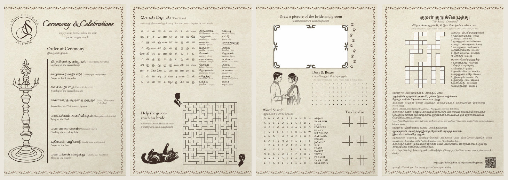

# Anjali & Samradh — Wedding Programme (Tamil + English)

**The design is `templates/programme-booklet.svg`** — one A4 sheet folded to four A5 pages:
1. Cover: AS monogram, *Ceremony & Celebrations*, order of ceremony, kuthuvilakku drawing
2. Tamil word search + maze ("Help the groom reach his bride") + cat
3. Draw-the-couple frame, Dots & Boxes, English word search, Tic-Tac-Toe
4. Thirukkural crossword, both verses (separated words, phonetics, Kalaignar உரை, G.U. Pope), QR code for the website, thank-you

```bash
python3 build.py --pdf          # output/programme-booklet.svg + .pdf (colour, on parchment)
python3 build.py --pdf --bw     # also output/programme-booklet-bw.svg + .pdf (black ink, no background)
```

Content comes from `wedding.json` (order of ceremony) and `games.json` (everything else).
**Fonts:** install every `.ttf` in `fonts/` in Windows (right-click → *Install for all users*) before opening any template in Inkscape.
Close any open PDF before building — Windows locks open files.

## Website (interactive version)

`web/` holds an interactive, phone-friendly version of the booklet: tap-or-drag word searches,
a playable maze, a drawing pad you can save, Dots & Boxes and Tic-Tac-Toe for two players, and the crossword with
Check / Reveal, plus the verses. It is built from the same `wedding.json` + `games.json`:

```bash
python3 web/build_web.py      # writes docs/index.html, docs/index.html, docs/assets/
```

Only the fields the page shows are copied into the page (no date, time or venue from the invitation).
Publish `docs/` with GitHub Pages - see "Publishing the website" below.

### Publishing the website

GitHub Pages is free for **public** repositories. Keep this project private and publish only the site
from a small public repository:

```bash
python3 web/build_web.py
mkdir -p ~/sources/anjali-samradh-games && cp -r docs/. ~/sources/anjali-samradh-games/
cd ~/sources/anjali-samradh-games
git init -b main && git add -A && git commit -m "Wedding games site"
gh repo create anjali-samradh-games --public --source=. --push
gh api -X POST repos/{owner}/anjali-samradh-games/pages -f "source[branch]=main" -f "source[path]=/"
```

The site appears at `https://<your-github-username>.github.io/anjali-samradh-games/` within a minute or two.
To update it later: rebuild, copy `docs/` across again, then `git add -A && git commit -m update && git push`
in the site folder.

## Project layout

```
templates/programme-booklet.svg  ← the design: edit in Inkscape
wedding.json                     ← order of ceremony (yours; not in the bundles)
games.json                       ← puzzles, verses, phonetics, website text
build.py                         ← fills the template, makes the PDFs
maze.py                          ← makes assets/maze.svg (the same maze is used on the website)
web/                             ← the website source; builds docs/
assets/                          ← images the booklet and website use
fonts/                           ← OFL fonts the booklet uses
output/                          ← generated: SVGs, PDFs, answer key
```



## Editing the design (template)

Open `templates/programme-booklet.svg` in Inkscape 1.2+ after installing the fonts in `fonts/`. Move, restyle or add anything, then save and rebuild. `build.py` only writes to `output/` and never changes the template. The template follows a few conventions:

| In the template | What build.py does |
|---|---|
| Text containing `{{programme.items.2.en}}` | Replaces it with that value from the JSON files (lists count from 0). Mixing placeholders with fixed text is fine. |
| Label starting with `?` (for example `?Item 7`) | Removes the object when its placeholders have no value, so unused ceremony slots vanish. |
| Text label containing `[w=200]` | Shrinks the text to fit 200 units wide (never below 11 px). `[wrap=W,LH]` wraps it instead; `[nofit]` leaves it alone. |
| Group labelled `#stack` | Closes up the gap when a line inside it is removed or wraps onto more lines. |
| Group labelled `#puzzle KEY` | Draws the word-search grid for `games.json` → `KEY` inside its rect labelled `area`, using the font and colour of its text labelled `letter`. |
| Group labelled `#list path.to.list` | Repeats its `entry` group for every item (`columns=`, `rows=` options). Inside it, use the item's fields (`{{word}}`, `{{gloss}}`, `{{ph}}`, …) and `{{n}}`. |
| Group labelled `#crossword key` | Draws the crossword using the samples labelled `cell`, `number` and `letter`. Its clue lists are `#list key.across` and `#list key.down`. |

Labels are the names in Inkscape's **Layers and Objects** panel (Ctrl+Shift+L); double-click a name to rename it.

## Editing the words

- **Order of ceremony:** `wedding.json` → `programme.items`, each with `_ta` and `_en` versions.
- **Word searches:** `games.json` → `tamil_words` / `english_words`: `words`, `bonus`, `rows`, `cols`, `seed` (a different shuffle), `directions` (any of `right down left up down-right up-right down-left up-left`) and `decoys`. Each word is checked to appear exactly once. Tamil words are split into letters as readers see them, so க், கா and கொ each take one box.
- **Crossword:** `games.json` → `crossword.grid`, one row per line, letters separated by spaces, `x` for an empty square. Numbering is automatic. Clues are matched by answer word in `crossword.clues`; the build warns about any answer with no clue.
- **Phonetics:** `games.json` → `phonetics` maps Tamil text to its pronunciation, for example `"தாலி": "thaali"`. `{{ph}}` shows it; the build lists any word that has none.

The answers go to the hidden **Answer Keys** layer and to `output/programme-booklet-answer-key.txt`. After a build, the script lists any placeholder with no matching value, which helps catch typos.

## Images

`assets/` holds the images the booklet links to as `../assets/...` (keep the folders side by side):
- `parchment-plain.jpg` - the paper; `border-open-left.png` / `border-open-right.png` - the stitched border, open at the fold so the top and bottom run on across the sheet (`-bw` versions are black, for the black-ink booklet). All made from `parchment.jpg` (Rawpixel: "Simple tribal pattern in doodle style frame" by Yanin - check its licence on rawpixel.com), which the website still uses.
- `kuthuvilakku.png`, `couple-drawing.png`, `cat-drawing.png`, `drawing-frame.png`, `monogram.svg`, `groom.svg`, `bride.svg`
- `qr-games.svg` - QR code for the website
- `maze.svg` / `maze-solution.svg` - regenerate with `python3 maze.py --color "#3a2c24" --stroke 4 --out assets/maze.svg`

## PDF from the command line

```bash
python3 build.py --pdf --bw                   # colour + black-ink PDFs
python3 build.py --pdf --bw --text-to-path    # text as outlines, for a print shop
```

This uses Inkscape 1.2 or newer. Under WSL it automatically uses the Windows install in `C:\Program Files\Inkscape` and the fonts installed in Windows. If Inkscape is somewhere else, point to it: `export INKSCAPE="/mnt/d/Apps/Inkscape/bin/inkscape.com"`. Before exporting, the build warns about any font the template uses that isn't in `fonts/`.

## Printing

The PDF has the four A5 pages in reading order. Print on A4 in **Booklet** mode (double-sided, flip on short edge) and fold. Use the `-bw` PDF to print in black ink only.

> **Page sizes.** If Inkscape stretches page 1 to the whole canvas when you save the template, `build.py` repairs it in the output automatically; `python3 build.py --fix-template` repairs the template itself. Check with the **Pages** tool (Shift+F7): page 1 should be A5 (148 × 210 mm).

## Requirements

Python 3 with Pillow (`pip install pillow`), so text fitting measures the real fonts instead of estimating.
