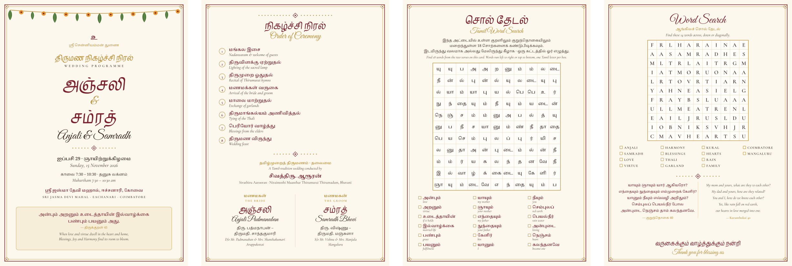

# Anjali & Samradh — Wedding Programme (Tamil + English)

**The final design is `templates/programme-booklet.svg`** — one A4 sheet folded to four A5 pages:
1. Cover: AS monogram, *Ceremony & Celebrations*, order of ceremony, kuthuvilakku drawing
2. Tamil word search + maze ("Help the groom reach his bride") + cat
3. Draw-the-couple frame with paw prints, Dots & Boxes, English word search, Tic-Tac-Toe
4. Thirukkural crossword, both verses (separated words, phonetics, Kalaignar உரை, G.U. Pope), thank-you

```bash
python3 build.py --pdf          # builds the final booklet -> output/programme-booklet.svg + .pdf
python3 build.py --all --pdf    # builds every design in templates/
```

Content comes from `wedding.json` (order of ceremony) and `games.json` (everything else).
**Fonts:** install every `.ttf` in `fonts/` in Windows (right-click → *Install for all users*) before opening any template in Inkscape.
Close any open PDF before building — Windows locks open files.

## Website (interactive version)

`web/` holds an interactive, phone-friendly version of the booklet: tap-or-drag word searches,
a playable maze, a drawing pad you can save, Dots & Boxes and Tic-Tac-Toe for two players, and the crossword with
Check / Reveal, plus the verses. It is built from the same `wedding.json` + `games.json`:

```bash
python3 web/build_web.py      # writes docs/index.html, docs/data.js, docs/assets/
```

Only the fields the page shows are copied into `docs/data.js` (no date, time or venue from the invitation).
Publish `docs/` with GitHub Pages - see "Publishing the website" below.

### Publishing the website

GitHub Pages is free for **public** repositories. Keep this project private and publish only the site
from a small public repository:

```bash
python3 web/build_web.py
mkdir -p ~/sources/anjali-samradh-games && cp -r docs/. ~/sources/anjali-samradh-games/
cd ~/sources/anjali-samradh-games
git init -b main && git add -A && git commit -m "Wedding games site"
gh repo create anjali-samradh-games --public --source=. --push
gh api -X POST repos/{owner}/anjali-samradh-games/pages -f "source[branch]=main" -f "source[path]=/"
```

The site appears at `https://<your-github-username>.github.io/anjali-samradh-games/` within a minute or two.
To update it later: rebuild, copy `docs/` across again, then `git add -A && git commit -m update && git push`
in the site folder.

---


This is a 4-page A5 booklet made from an **Inkscape template** and a **JSON content file**. You don't need to touch the code to change the design or the wording.



```
templates/programme-a5.svg   ← the design: edit in Inkscape
wedding.json                 ← the words: names, ceremony, puzzle words
build.py                     ← fills the template (no changes needed)
output/                      ← generated: SVG, answer key, proof PDF
fonts/                       ← OFL fonts used by the template
```

```bash
python3 build.py             # template + wedding.json  →  output/wedding-programme.svg
python3 build.py --all       # every templates/*.svg     →  output/<template-name>.svg
```

### Designs in `templates/`

| Template | Look |
|---|---|
| `programme-a5.svg` | Classic: maroon and gold, mango-leaf thoranam, kolam dividers |
| `modern-minimal.svg` | Black on warm white, light sans-serif, thin rules |
| `modern-arch.svg` | Terracotta, blush and sage, arch-framed cover, tiled puzzle grid |
| `modern-editorial.svg` | Deep green colour blocks, mustard accents, large serif names |

| `programme-booklet.svg` | **Final booklet** (based on Anjali's layout): parchment pages · 1: AS monogram, welcome, order of ceremony · 2: Tamil word search + "help the groom reach his bride" maze · 3: drawing frame, Match the Words, English word search · 4: Thirukkural crossword, verses with phonetics, Kalaignar urai and Pope translation |
| `games-booklet.svg` | **Games booklet**: one A4 sheet folded to four A5 pages. 1: order of ceremony · 2: Thirukkural crossword, its clues, and both verses in Tamil with English phonetics · 3: Tamil word search and Tamil–English matching · 4: English word search, word scramble, thank-you, answers upside down |

The games booklet reads `wedding.json` (the order of ceremony) and **`games.json`** (everything else, including the verses and their phonetics under `verses`). By default `build.py` loads both files; you can also name them yourself with `-d wedding.json -d games.json`.

**Phonetics:** `games.json` → `phonetics` maps Tamil text to its English pronunciation, for example `"தாலி": "thaali"`. Inside any `#list` entry, `{{ph}}` shows the phonetic form of the item's `ta` or `word`, and `{{ph_paren}}` shows the same with a leading space and brackets (empty when there is none). The ceremony steps in `wedding.json` are looked up the same way, so that file needs no changes. If an entry uses `{{ph}}` and a word has no phonetic form, the build lists the missing words.

**Crossword:** in `games.json` → `crossword.grid`, write one row per line, letters separated by spaces, and `x` for an empty square. Numbering is automatic. Clues are matched by answer word in `crossword.clues`, and the build warns about any answer with no clue. The answers go to the hidden Answer Keys layer and to `output/games-booklet-answer-key.txt`.

The new template markers:
- `#list path.to.list` repeats an `entry` for every item.
  - Inside the entry, use the item's fields (`{{q}}`, `{{a}}`, …) and `{{n}}`.
  - `{{letter}}` gives A, B, C… and `{{scrambled}}` gives the item's `word` with its letters shuffled.
  - The `shuffle=11` option mixes the order; the matching game uses it.
  - Answer strings appear automatically, such as `{{trivia.questions_answers}}`, `{{match.pairs_match}}` and `{{scramble.words_answers}}`.
- `#crossword key` draws the grid, using the samples labelled `cell`, `number` and `letter`. Its clue lists are `#list key.across` and `#list key.down`.

The modern booklet templates read the same `wedding.json`. The modern ones also use `cover.bride_en`, `cover.groom_en` and `cover.date_short`. Build one design on its own with `python3 build.py -t templates/modern-arch.svg -o output/modern-arch.svg`.

Puzzle styling belongs to each template and goes in the marker label. Settings there override `wedding.json`:
- `#puzzle tamil_puzzle lines=off scale=0.36 inset=0.06`: no grid lines, letter size relative to the cell, and the gap around each tile.
- Inside the `#puzzle` group:
  - a rect labelled `cell` is drawn behind every letter (rounded tiles);
  - a line labelled `cell line` sets the grid-line style;
  - a shape labelled `answer` sets the answer-key colour.
- `#wordlist tamil_puzzle columns=3` sets the number of word-list columns.

Run `python3 build.py --help` to use another template or data file, for example a second design or a different couple.

## Editing the design (template)

Open `templates/programme-a5.svg` in Inkscape 1.2+ after installing the fonts in `fonts/`. Move, restyle, recolour, add artwork or delete anything, then save and rebuild. The template follows a few simple conventions.

| In the template | What build.py does |
|---|---|
| Text containing `{{cover.bride_ta}}` | Replaces it with that value from `wedding.json`. Lists count from 0: `{{programme.items.2.en}}`. Mixing placeholders with fixed text is fine: `Date: {{cover.date_en}}`. |
| Label starting with `?` (for example `?Item 7`) | Removes the object when its placeholders have no value, so unused ceremony slots vanish. |
| Text label containing `[w=200]` | Shrinks the text to fit 200 units wide. Other filled-in text is automatically kept within its page margins. |
| Group labelled `#puzzle tamil_puzzle` | Draws the word-search grid inside its rect labelled `area`, using the font and colour of its text labelled `letter`. |
| Group labelled `#wordlist tamil_puzzle` | Repeats its group labelled `entry` for every word, in `list_columns` columns across its rect labelled `area`. Inside the entry, `{{word}}` and `{{gloss}}` are filled per word. |

Labels are the names in Inkscape's **Layers and Objects** panel (Ctrl+Shift+L); double-click a name to rename it.

### Common changes

- **More ceremony steps:** duplicate the `?Item 8` group (Ctrl+D), move it down, and change its placeholders to `items.8`. Then add the item to `wedding.json`.
- **Show a new field:** add it to `wedding.json` (for example `"cover": { "hashtag": "#AnjaliWedsSamradh" }`), then add a text in Inkscape that says `{{cover.hashtag}}`.
- **Move or resize a puzzle:** move or resize its `area` rect. The grid is fitted inside it with square cells.
- **Restyle puzzle letters:** change the font or colour of the `letter` sample text.
- **Restyle the word list:** edit the sample `entry` (tick box, word and gloss styles, and their positions).
- **Answer-key colour:** add any small shape labelled `answer` inside the `#puzzle` group; its colour is used.
- **Other page sizes or layouts:** copy the template, redesign it, and build with `-t templates/your-template.svg`.

Running `build.py` only writes to `output/` and never changes the template.

## Editing the words (`wedding.json`)

- **Text on the card:** each item on the card is a named value, usually with `_ta` and `_en` versions.
- **Puzzle settings:**
  - `rows` and `cols` set the grid size; `seed` gives a different shuffle; `directions` are any of `right down left up down-right up-right down-left up-left`.
  - `letter_scale` sets letter size relative to the box; `cell_lines` turns the grid lines on or off; `list_columns` sets the number of word-list columns.
- **Tamil word splitting:** Tamil words are split into letters as readers see them, so க், கா and கொ each take one box.
- **Word counts:** `{{tamil_puzzle.count}}` gives the number of words automatically.

After a build, the script lists any placeholder with no matching value, which helps catch typos.

## Images used by the booklet

`assets/` holds the images the final booklet links to (the template and output refer to them as `../assets/...`, so keep the folders side by side):
- `parchment.jpg` - background (from Rawpixel: "Simple tribal pattern in doodle style frame" by Yanin - check its licence on rawpixel.com)
- `drawing-frame.png` - the ornate frame for the drawing box
- `maze.svg` / `maze-solution.svg` - regenerate with `python3 maze.py --size 27 --hardest 300 --color "#3a2c24" --out assets/maze.svg`

The AS monogram and the groom/bride silhouettes are drawn inside the template itself.

## PDF from the command line

```bash
python3 build.py --pdf                        # output/wedding-programme.svg + .pdf
python3 build.py --all --pdf                  # a PDF for every template
python3 build.py --all --pdf --text-to-path   # text as outlines, for a print shop
```

This uses Inkscape 1.2 or newer. Under WSL it automatically uses the Windows install in `C:\Program Files\Inkscape` and the fonts installed in Windows. If Inkscape is somewhere else, point to it: `export INKSCAPE="/mnt/d/Apps/Inkscape/bin/inkscape.com"`. Before exporting, the build warns about any font a template uses that isn't in `fonts/`.

## Printing

> **Page sizes.** Inkscape uses the document's own size as page 1. When the template is saved in Inkscape, page 1 can get stretched to the whole 4-page canvas, and the PDF then has a giant first page. `build.py` repairs this in the output automatically. `python3 build.py --fix-template` also repairs the template file itself. To check, open Inkscape's **Pages** tool (Shift+F7) and click page 1: the toolbar should show A5 (148 × 210 mm).

1. Open `output/wedding-programme.svg` in Inkscape.
2. Use File → Save a Copy → PDF and choose *Convert text to paths* for the print shop. You get 4 A5 pages in reading order.
3. Print on A4 in **Booklet** mode and fold.
4. The **Answer Keys (hidden)** layer is off by default. Turn it on to check the puzzles.

## Requirements

Python 3 is enough. With Pillow installed (`pip install pillow`), text fitting measures the real fonts instead of estimating.
